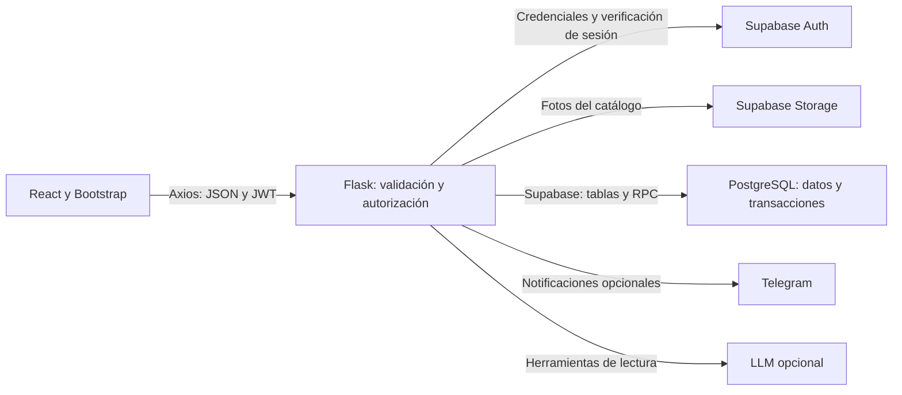
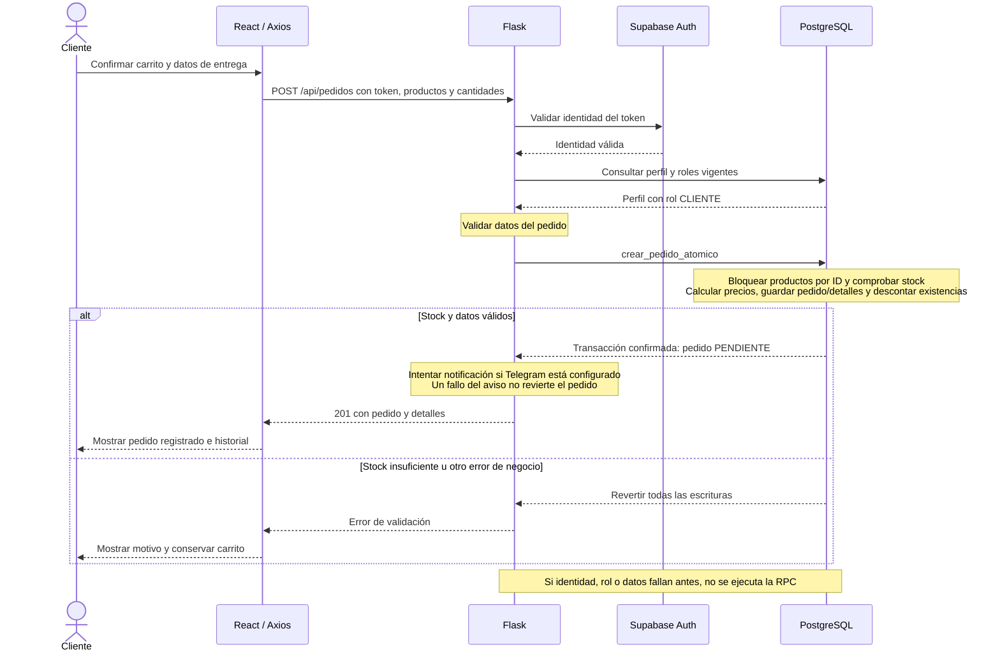
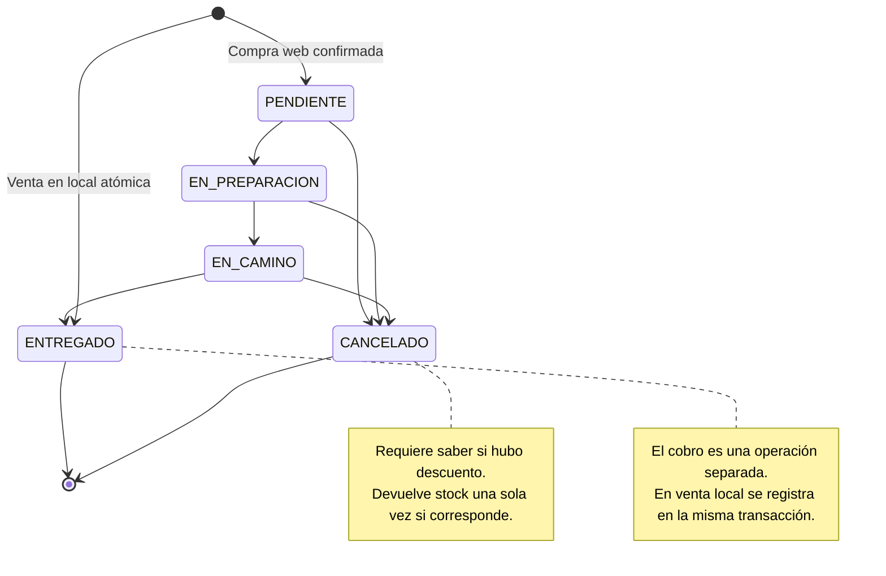

# Guía técnica para la defensa — Pizzería Muñeco

## Qué problema resuelve el sistema

Permite al cliente elegir pizzas y tamaños, registrar un pedido y consultar su
estado. El vendedor procesa pedidos y registra ventas y métodos de pago. El
administrador mantiene catálogo, inventario y usuarios, y consulta reportes.
Telegram avisa de pedidos nuevos y stock bajo; el asistente permite consultas
sobre datos operativos cuando se configure el proveedor externo.

## Responsabilidades de cada tecnología

React maneja la interacción y el estado visual. Context API conserva sesión y
carrito sin agregar otra librería de estado. Axios hace las solicitudes HTTP.
Flask valida los datos y los permisos. Supabase ofrece el acceso al PostgreSQL
alojado. Las funciones SQL resuelven las escrituras que deben ocurrir juntas.

## Roles combinables y seguridad

`usuarios.roles` guarda un arreglo, por ejemplo `['CLIENTE','VENDEDOR']`.
El decorador `rol_requerido('ADMINISTRADOR','VENDEDOR')` hace una comprobación OR:
basta tener alguno de los roles autorizados. Cada solicitud protegida consulta
los roles vigentes en PostgreSQL, evitando que un token antiguo mantenga un
permiso retirado. Las rutas de React ocultan pantallas; Flask garantiza el acceso.

Supabase Auth gestiona contraseñas, confirmaciones y recuperación por correo,
y emite access/refresh tokens. Flask verifica la identidad en Auth y la vincula
por `usuarios.auth_user_id`; no firma JWT propios. Los hashes heredados se
eliminan al migrar cada cuenta, conservando IDs e historial. El registro público
no puede elegir roles. Storage almacena las fotos del catálogo; las cargas se
autorizan en Flask y admiten JPEG/PNG/WebP hasta 5 MB. La activación real requiere
las migraciones 003/004 y la configuración de Auth descrita en SUPABASE_ACTIVACION.md.
Las tablas tienen RLS y acceso reservado al backend; las claves secretas no
están en el navegador. El último administrador no puede perder ese rol.

## Tamaños, precio y stock

Cada fila de productos representa una opción vendible. Una Margarita Mediana y
una Margarita Familiar tienen IDs diferentes, precio propio e inventario propio.
El catálogo agrupa opciones por nombre/categoría. Esta decisión conserva las
relaciones de inventario y pedido existentes sin añadir un segundo modelo de stock.

El detalle del pedido almacena nombre, tamaño y precio al momento de comprar.
Cambiar luego el nombre o precio del catálogo no altera la evidencia histórica.
El carrito muestra un total estimado: la base recalcula con los precios reales.

## Transacciones y concurrencia

Crear un pedido realiza en una transacción: validación de disponibilidad,
cálculo del total, cabecera, detalles y descuento de stock. Un error revierte
las escrituras. Esto demuestra atomicidad y mantiene la consistencia del negocio.
Los bloqueos por fila serializan compras del mismo producto; se adquieren en
orden de ID para reducir conflictos. Las pruebas aisladas verifican rollback.
`backend/tests/concurrencia.py` comprueba con sesiones independientes de
PostgreSQL la última unidad, una compra tras rollback, dos cancelaciones y dos
cobros simultáneos. El runner observa el bloqueo antes de liberar la primera
transacción y comprueba los datos finales. Los cuatro casos pasaron el 19 de
octubre de 2026 en PostgreSQL 16.15 temporal.

Cancelar bloquea el pedido y devuelve stock una sola vez.
La marca `stock_descontado` impide devolver cantidades que nunca se reservaron.
Los pedidos anteriores requieren conciliación porque su código podía no descontar stock. No se puede reabrir
un pedido cancelado o entregado. Los cambios quedan en `historial_estados`.
La edición de inventario compara el stock que vio el administrador con el vigente:
si cambió por otra operación, se rechaza el ajuste hasta recargar la información.

## Ventas, cobros y reportes

El pedido representa una orden; la venta representa su cobro registrado.
Solo un pedido entregado puede cobrarse y la restricción UNIQUE de ventas.pedido_id
impide dos ventas del mismo pedido. La venta en local crea pedido y cobro juntos.
Se registra EFECTIVO, QR o TARJETA; no se realiza una transacción bancaria.

Los reportes usan ventas registradas, no pedidos pendientes. PostgreSQL agrega
los datos para evitar totales incompletos por límites de listado. Se consulta por
fechas en horario de Bolivia y se muestran productos, tamaños, pagos y ventas diarias.
El consumo semanal representa productos reservados/vendidos en pedidos no cancelados.
Todavía no hay tablas de recetas o materias primas. El control de insumos fue
solicitado el 19 de octubre para la siguiente etapa de implementación.

## Asistente y Telegram

El LLM selecciona funciones predefinidas. Flask ejecuta solamente herramientas
autorizadas de lectura y devuelve sus datos para que el modelo redacte la respuesta.
No se ejecuta SQL generado por el modelo ni se le permite modificar permisos.
El acceso es exclusivo del administrador, las llamadas tienen límites y las
claves se configuran en el servidor. La opción preparada usa OpenAI Responses;
la elección del proveedor/modelo y su validación real siguen pendientes.

Telegram envía avisos después de confirmar el pedido. Si falla el envío, no se
pierde una compra. Actualmente es de mejor esfuerzo, sin reintentos persistentes.
Bot, chat y credenciales todavía deben configurarse y probarse.

## Evidencias y límites

- Pruebas Python: validaciones, permisos de los tres roles y sus siete combinaciones,
  revocación de roles con JWT vigente e integraciones simuladas.
- Pruebas SQL: migración de usuarios, atomicidad, stock por tamaño, estados,
  devolución de stock, cobros duplicados y reportes, en PostgreSQL PGlite aislado.
- Concurrencia: cuatro escenarios con conexiones PostgreSQL independientes,
  observación de bloqueos y comprobación del stock, historial y ventas finales.
- Prueba de navegador: React, Axios, Flask real y PostgreSQL mediante adaptador local.
  Incluye cliente, vendedor, administrador y recuperación/renovación con Auth
  simulado. No se conecta al Supabase del estudiante.
- Build y ESLint comprueban compilación y reglas de JavaScript; no prueban el negocio.

Para el cierre académico se necesitan también las pruebas específicas pendientes
de Auth/Storage en Supabase, Telegram/LLM reales, diagramas revisados y aceptación.
El código implementado no equivale a todo el sistema desplegado y aceptado.

## Demostración sugerida

1. Registrarse como cliente, elegir un tamaño y confirmar un pedido.
2. Mostrar detalle y estado del pedido; comprobar stock descontado.
3. Como vendedor, avanzar los estados y registrar el pago al entregar.
4. Registrar una venta en local y mostrarla en el historial.
5. Como administrador, editar producto, ajustar stock y asignar roles combinados.
6. Retirar un rol y demostrar que el token anterior no concede ese permiso.
7. Mostrar reportes de las ventas y pruebas de cancelación/cobro duplicado.
8. Demostrar Telegram y asistente cuando estén configurados; explicar sus límites.

## Revisión del documento académico — 19 de octubre

Esta revisión corresponde a la tarea documental ya existente del buffer. No
agrega tareas a los sprints ni modifica `proyecto_grado.odt`. El asistente se
reserva para el final por decisión del estudiante.

Se contrastaron requerimientos (Tablas 4/5), historias (Tabla 6), actores
(Tabla 8), planificación (Tabla 9), incrementos escritos y la imagen de la
Figura 24 con el código. La planificación técnica conserva sus casillas, pero
no cubre por sí sola todo el alcance del documento.

| Elemento | Resultado de la revisión |
|---|---|
| HU-06 y HU-07 | Mesa/para llevar y reserva con hora están escritos, pero no implementados |
| RF-04 | Tamaños implementados; falta combinar hasta dos sabores en una sola pizza |
| HU-10, HU-11, HU-12, HU-14 | Productos e insumos no son equivalentes; falta la parte de materias primas y su consumo |
| Figura 24 | Falta VENDEDOR, aunque está en la Tabla 8; añadir sus asociaciones al gestionar pedidos y registrar cobros |
| Relación pedido/venta en Figura 24 | Retirar el include obligatorio entre realizar pedido y registrar venta: la compra web puede quedar pendiente sin cobro |
| Sesión y JWT | Describir Supabase Auth como emisor de identidad y la lectura de roles vigentes en Flask; conservar la evolución histórica si corresponde |
| Sprint 3 | Actualizar aceptación del flujo y conciliación del pedido #1 con las evidencias informadas, sin inventar capturas |
| Tabla 9 | Fechas de encabezados de PLANIFICACION_SCRUM.md alineadas con las del ODT |
| Incrementos posteriores | El ODT desarrolla hasta Sprint 3; faltan las secciones correspondientes a los incrementos siguientes |
| Modelos anunciados | El texto remite a modelos en 3.2.6, despliegue en 3.2.7.3 y entidad-relación en 3.2.8.1; completar y comprobar las referencias al incorporarlos |
| CAPTCHA | Aparece como fundamento teórico; todavía no constituye una funcionalidad implementada |

Las cuentas pueden reunir varios roles; el administrador no hereda CLIENTE
automáticamente. Por eso el diagrama de casos de uso debe asociar cada rol a sus
operaciones, sin una generalización que conceda permisos inexistentes. El catálogo
es público. El historial y la compra web requieren CLIENTE; el cobro y los estados
requieren VENDEDOR o ADMINISTRADOR; productos, inventario, usuarios y reportes
requieren ADMINISTRADOR.

### Secuencia de confirmación del pedido implementada

### Estados del pedido implementados

Estos diagramas describen el sistema actual. Mesa, reservas, insumos y mitades
deben reflejarse cuando sus flujos estén implementados y validados. La revisión
identifica correcciones; no certifica que el documento académico ya esté terminado.
