# Propuesta para los apartados 3.2.6, 3.2.7 y 3.2.8

Modelos basados en el código disponible al 20 de octubre de 2026. Ajustar los
números de figura a la numeración del documento de titulación. Fuente de todas
las figuras: elaboración propia a partir del sistema implementado.

## 3.2.6 Modelado del sistema

El modelado representa las funcionalidades, la estructura del dominio y las
interacciones del sistema web de la Pizzería Muñeco. Se emplean diagramas UML de
casos de uso, clases, actividades y secuencia para describir el pedido del cliente,
la operación de entrega y el registro del cobro.

### 3.2.6.1 Diagramas de casos de uso por módulo

Los actores son visitante, cliente, vendedor y administrador. Una cuenta puede
combinar roles. El visitante consulta el catálogo y prepara el carrito; confirmar
el pedido requiere CLIENTE. Vendedor y administrador gestionan pedidos y cobros.
La administración y los reportes requieren ADMINISTRADOR. Supabase Auth participa
como servicio externo en los procesos de acceso.

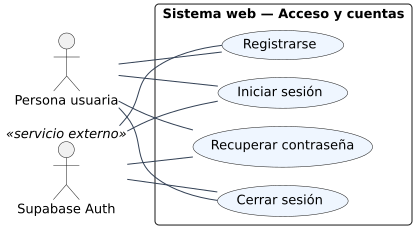

Figura: acceso y cuentas, CU-01 a CU-04.

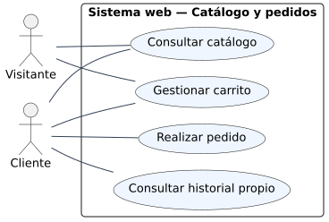

Figura: catálogo y pedidos, CU-05 a CU-08.

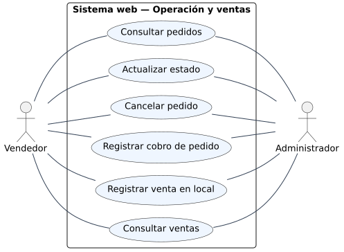

Figura: operación y ventas, CU-09 a CU-14.

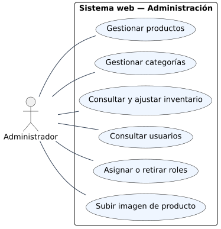

Figura: administración, CU-15 a CU-20.

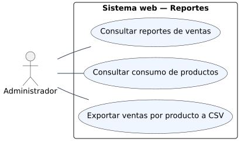

Figura: reportes, CU-21 a CU-23.

### 3.2.6.2 Especificaciones detalladas de casos de uso

Las [23 fichas de casos de uso](CASOS_DE_USO.md) contienen identificador, actor,
objetivo, precondiciones, flujo principal, alternativas y postcondiciones. La
correspondencia con los diagramas de casos de uso se establece por el nombre;
los códigos se conservan en las fichas.
Las operaciones protegidas validan la identidad con Auth y consultan los roles
vigentes en el servidor.

### 3.2.6.3 Diagrama de clases

El modelo conceptual incluye Usuario, Categoria, Producto, Inventario, Pedido,
DetallePedido, Venta e HistorialEstado. Los roles son valores combinables del
usuario. Cada opción vendible tiene tamaño, precio e inventario propios. El
detalle preserva nombre, tamaño y precio de la compra. Este es un modelo del
dominio, no una representación de clases ORM existentes en Flask.

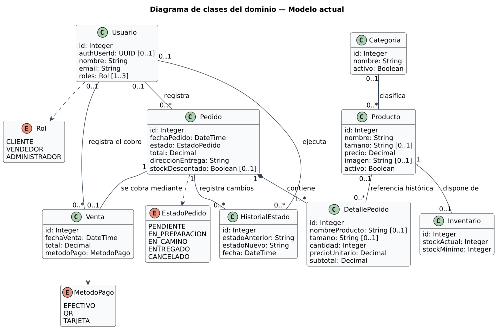

Figura: clases del dominio.

Uno o varios detalles por pedido es una regla del flujo de creación; la FK del
modelo físico no impone ese mínimo. Las referencias opcionales a usuarios y
productos contemplan las claves foráneas que admiten NULL.

### 3.2.6.4 Diagramas de actividades

Las actividades representan decisiones y flujos principales. Los carriles
separan las acciones humanas, las validaciones de Flask y las transacciones SQL.

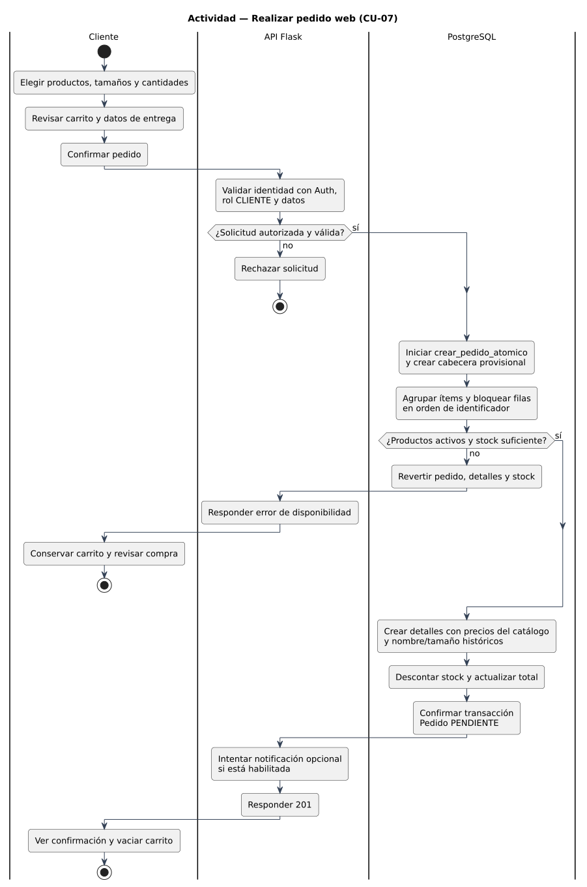

Figura: realizar pedido web, CU-07.

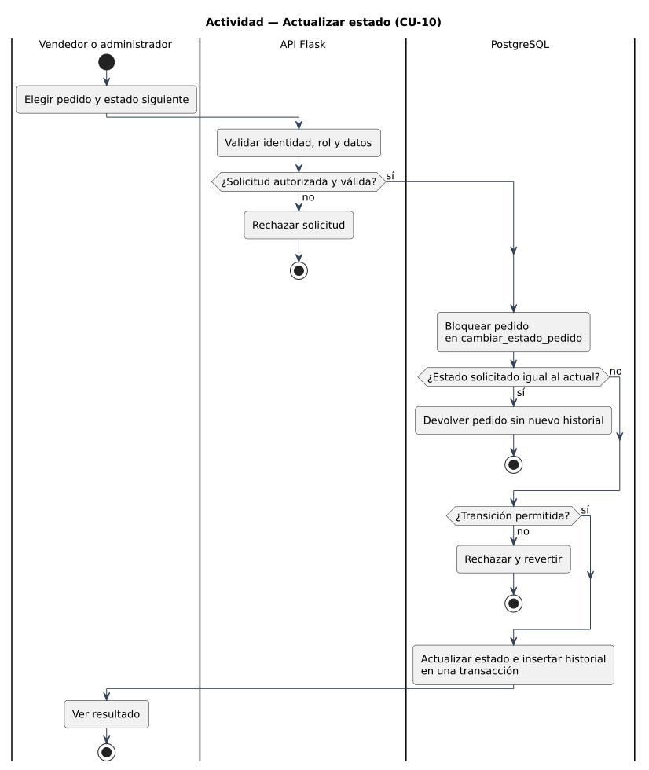

Figura: actualizar estado del pedido, CU-10.

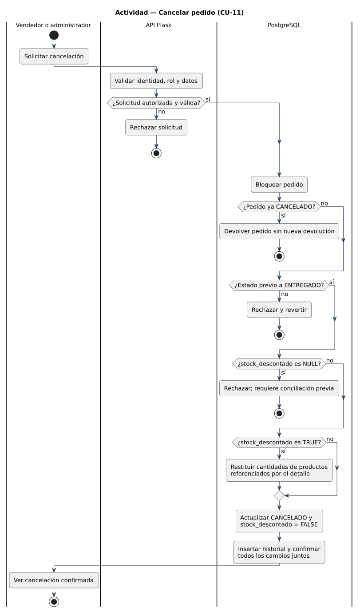

Figura: cancelar pedido y restituir existencias, CU-11.

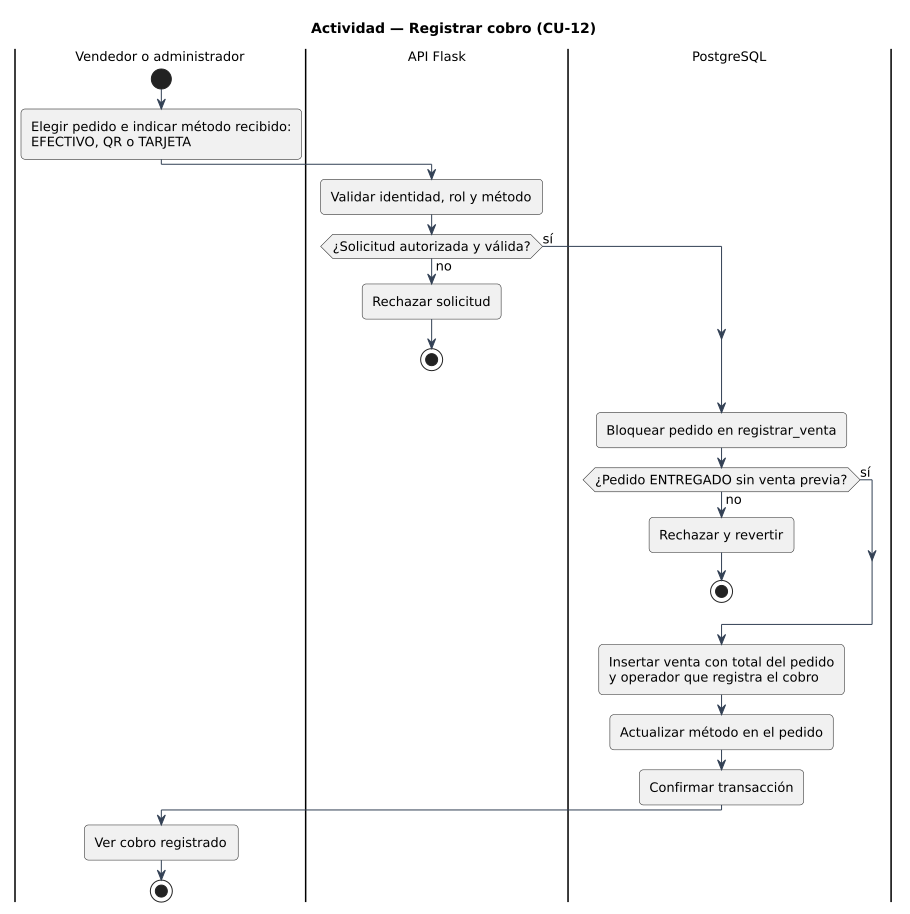

Figura: registrar cobro, CU-12.

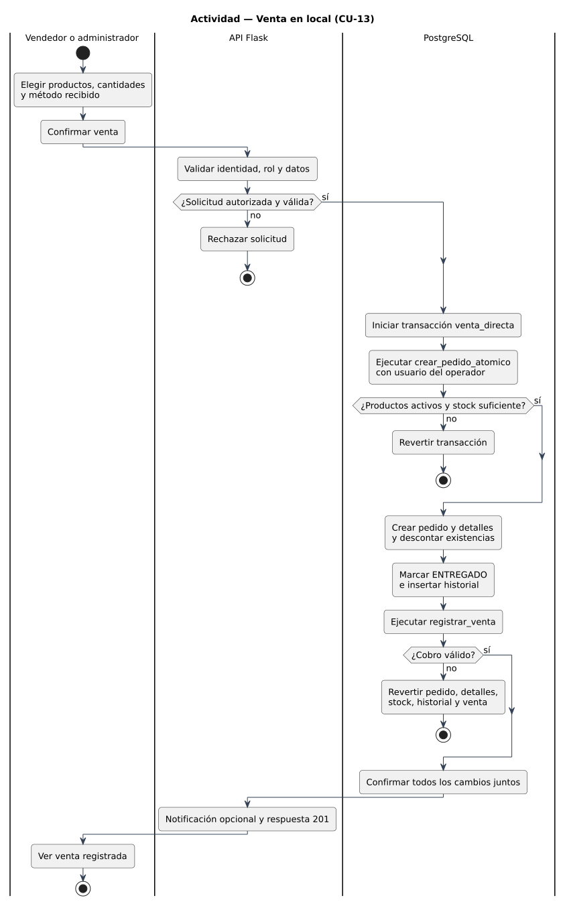

Figura: registrar venta local, CU-13.

Los pedidos ENTREGADO o CANCELADO no se reabren. Cancelar exige conocer si se
descontó stock; un valor heredado NULL bloquea la operación hasta conciliarlo.
El cobro registra el método recibido y no procesa un pago bancario.

### 3.2.6.5 Diagramas de secuencia

Las secuencias muestran los mensajes entre React, Flask, Auth, la API de datos
y PostgreSQL. La API de datos se separa de la base para explicar el uso de
consultas y funciones RPC mediante Supabase.

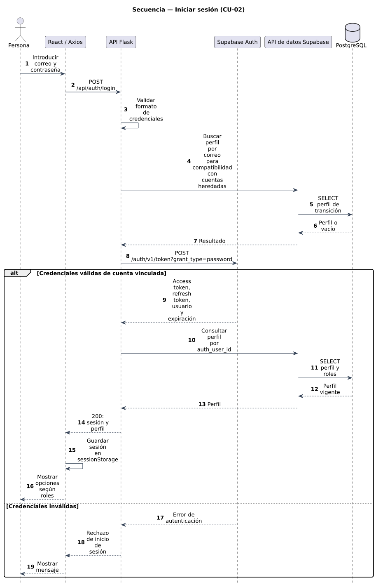

Figura: iniciar sesión con cuenta vinculada, CU-02.

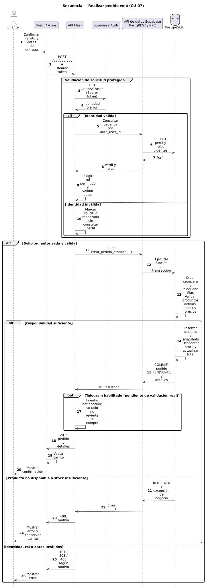

Figura: realizar pedido, CU-07.

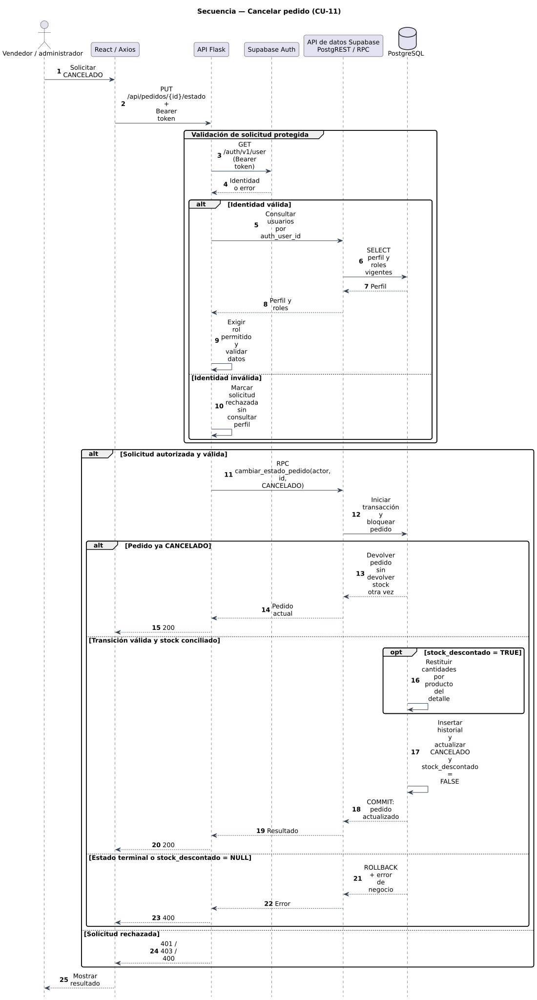

Figura: cancelar pedido, CU-11.

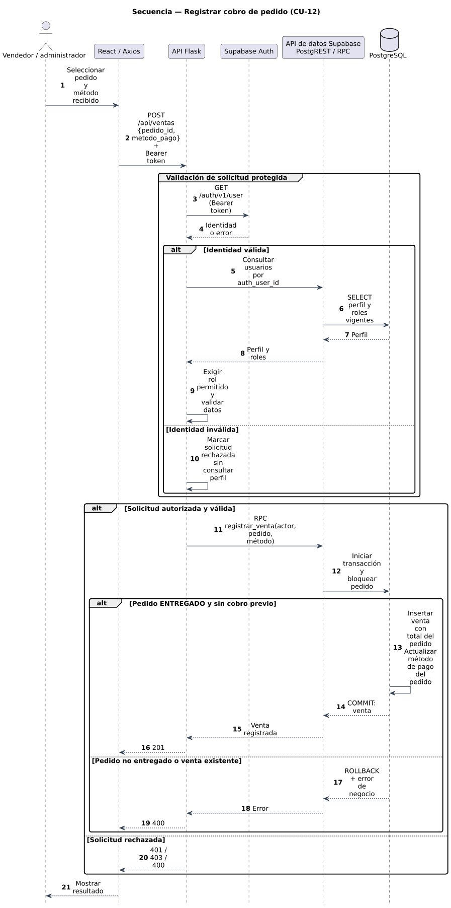

Figura: registrar cobro, CU-12.

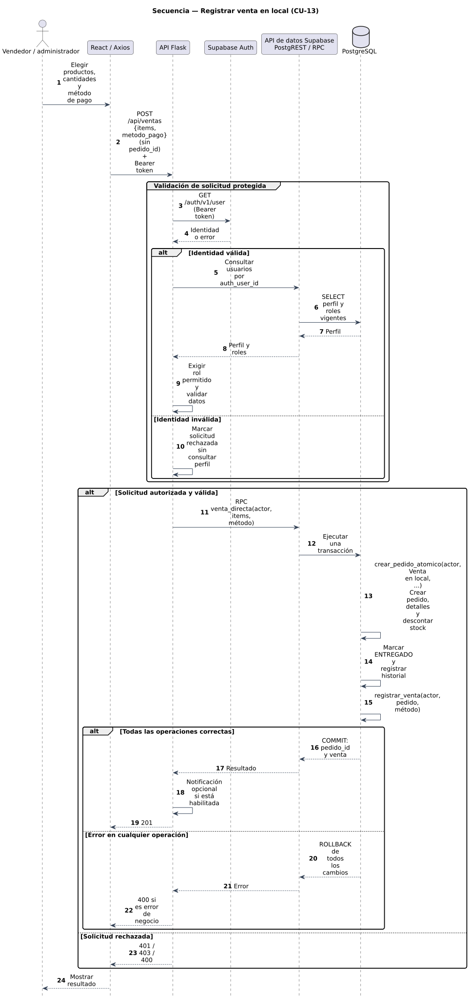

Figura: registrar venta local, CU-13.

Los fragmentos alternativos representan rechazos de autorización o negocio.
Una excepción SQL revierte todos los cambios de la función. Estas vistas no
enumeran todos los fallos de infraestructura posibles.

## 3.2.7 Arquitectura del sistema

### 3.2.7.1 Arquitectura de la aplicación

React proporciona las vistas y Context API administra sesión y carrito. Axios
comunica la interfaz con Flask, donde se validan datos y permisos. Supabase ofrece
Auth para credenciales y sesiones, PostgreSQL para persistencia y Storage para
imágenes. Las funciones SQL ejecutan operaciones atómicas de pedido, inventario y
cobro. Esta distribución describe responsabilidades lógicas y no presupone ORM
o microservicios.

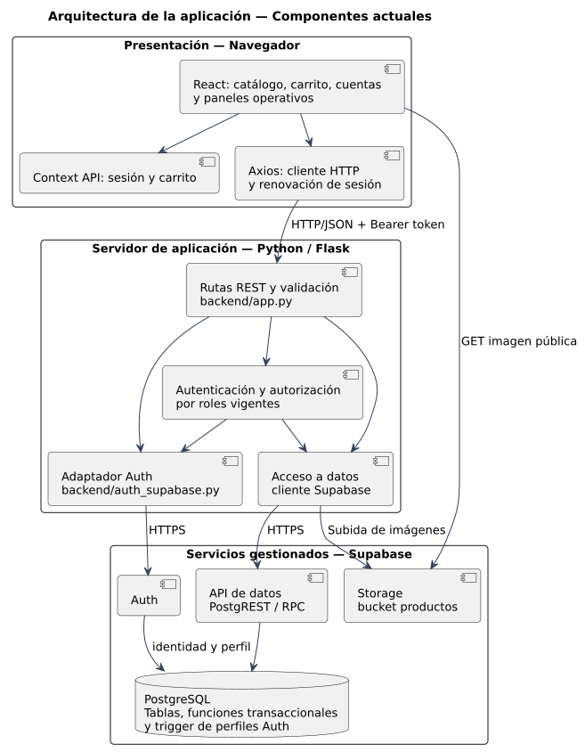

Figura: arquitectura de la aplicación.

### 3.2.7.2 Arquitectura de comunicación

La interfaz intercambia JSON con la API REST. Las rutas protegidas reciben
`Authorization: Bearer`; Flask valida la identidad con Auth y consulta los roles
del perfil. Axios también solicita la renovación de sesión al backend. La carga
de fotos usa `multipart/form-data`; el navegador lee las imágenes públicas de
Storage por su URL. Las conexiones a Supabase utilizan HTTPS.

El desarrollo local utiliza HTTP; HTTPS para el acceso a la aplicación corresponde
al despliegue productivo propuesto. La clave de servicio permanece en el backend.
Las tablas tienen RLS habilitado y acceso operativo reservado al servidor, donde
se aplica la autorización de la aplicación.

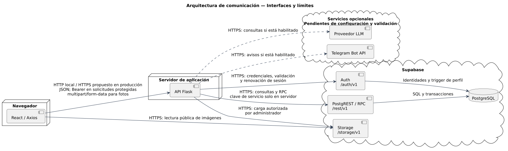

Figura: arquitectura de comunicación.

Telegram y LLM aparecen como servicios opcionales: su código está preparado y su
configuración y validación reales siguen pendientes. Los avisos de Telegram son
intentos sin cola persistente; su fallo no revierte un pedido confirmado.

### 3.2.7.3 Diagrama de despliegue

El entorno documentado ejecuta Vite y Flask en el equipo de desarrollo y utiliza
Supabase remoto. El navegador carga React desde Vite y consulta Flask mediante
la dirección configurada. Los puertos habituales son 5173 y 5000, ajustables.

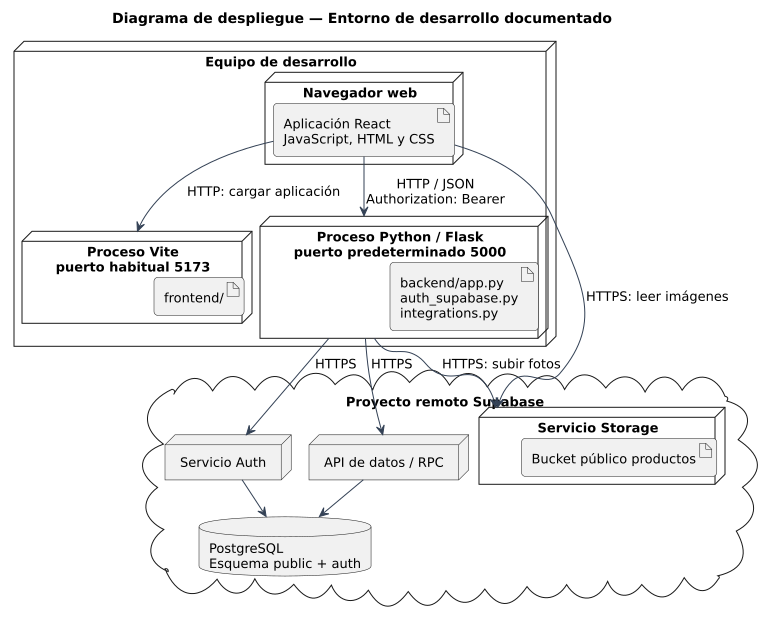

Figura: despliegue del entorno de desarrollo.

El alojamiento de producción deberá documentarse cuando se elija y despliegue.
La figura no afirma que exista dominio, proxy o servidor productivo configurado.

## 3.2.8 Diseño de la base de datos

### 3.2.8.1 Modelo entidad-relación

El esquema operativo contiene usuarios, categorias, productos, inventario,
pedidos, detalle_pedidos, ventas e historial_estados. Se referencia además
`auth.users`, administrada por Supabase. Storage guarda las imágenes; productos
conserva la URL sin introducir una tabla propia de archivos.

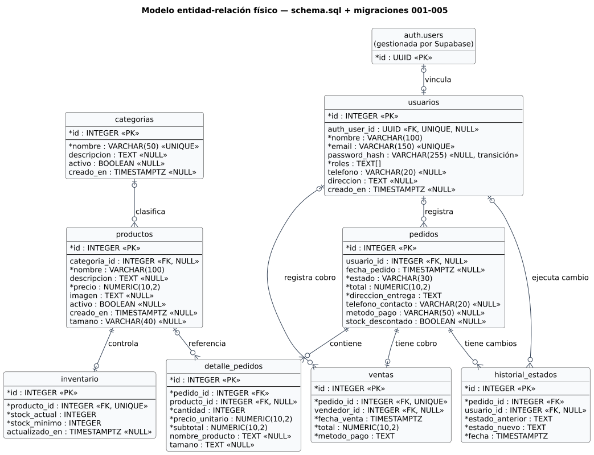

Figura: modelo entidad-relación físico vigente, esquema y migraciones 001–005.

Las cardinalidades representan el DDL. La aplicación crea el inventario de un
producto, aunque la FK no exige que todo producto tenga esa fila. La unicidad de
`ventas.pedido_id` permite un máximo de un cobro por pedido. El detalle conserva
instantáneas históricas de nombre, tamaño y precio. Los roles son un arreglo.

### 3.2.8.2 Diccionario de datos

El [diccionario](DICCIONARIO_DATOS.md) registra tipos, nulabilidad, claves,
valores predeterminados y restricciones de las ocho tablas. Incluye el vínculo
con Auth, roles combinables, tamaños y control del descuento de stock. La columna
antigua `rol` fue eliminada por 005; `password_hash` permanece únicamente para
la transición de cuentas heredadas.
